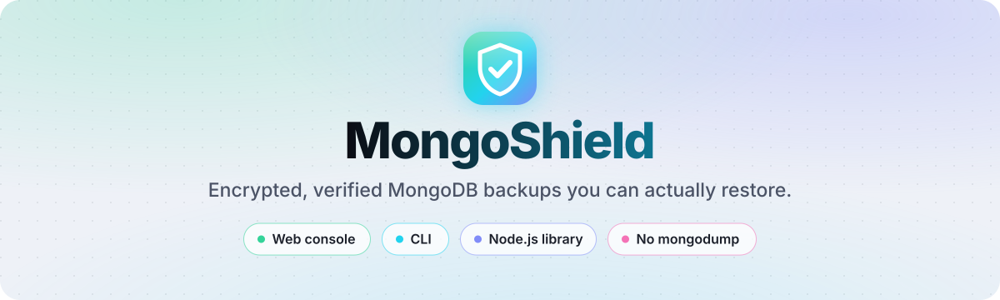
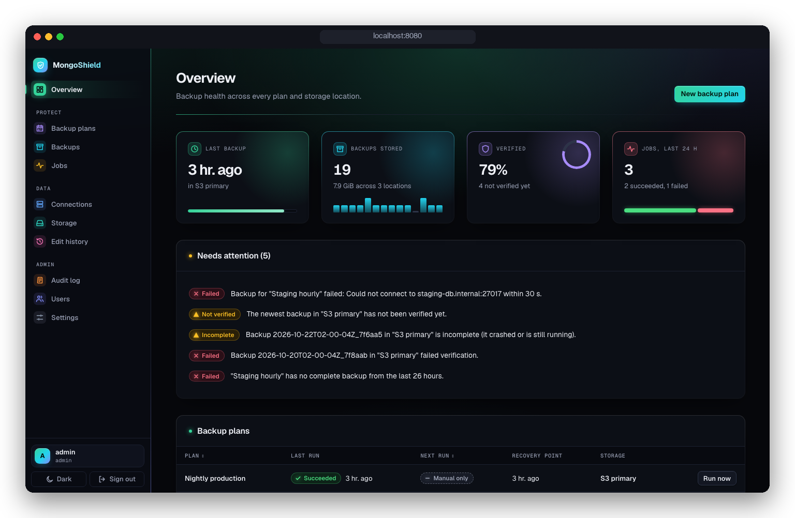
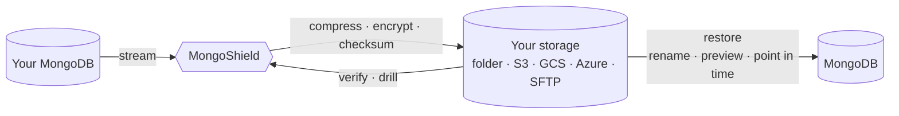
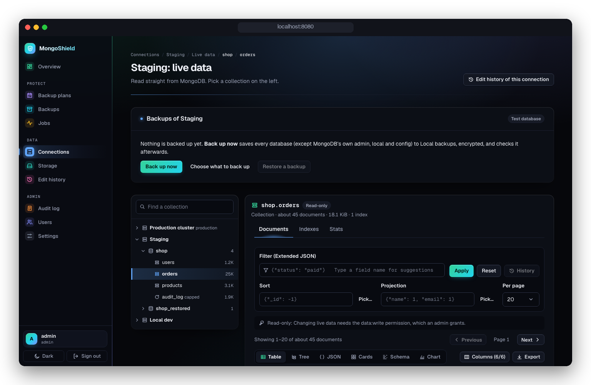
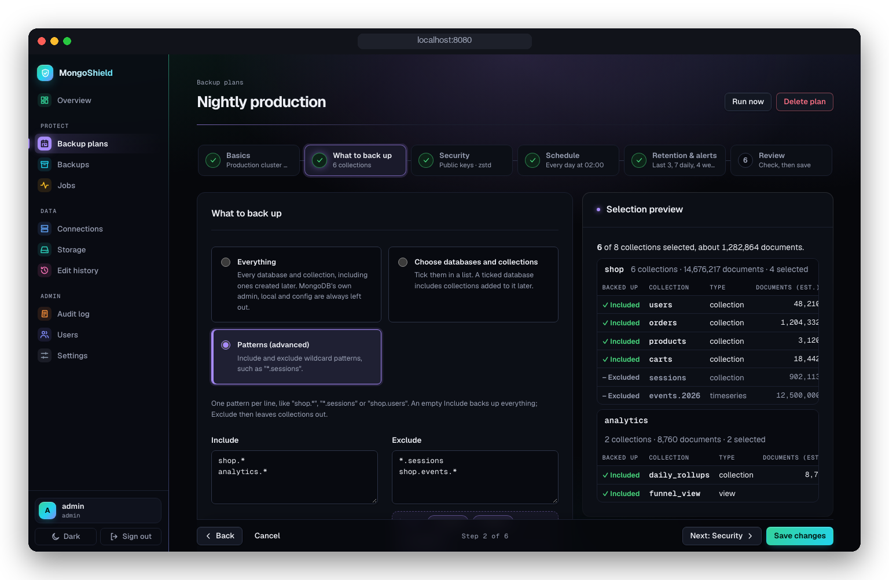
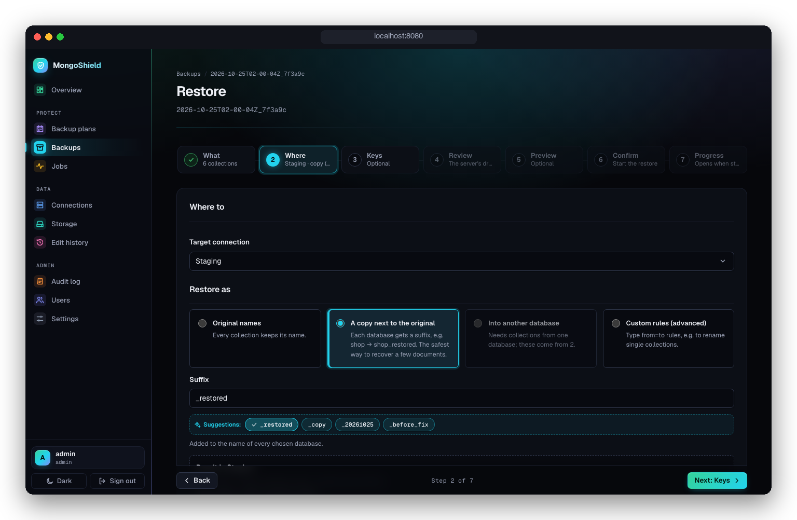

<div align="center">

<picture>
  <source media="(prefers-color-scheme: dark)" srcset="docs/assets/banner-dark.svg">
  
</picture>

<br>
<br>

<a href="https://github.com/ShamalRathnayake/mongoshield/actions/workflows/ci.yml"></a>


<br>
<br>

**[Quick start](#quick-start)** &nbsp;·&nbsp;
**[Web console](#the-web-console)** &nbsp;·&nbsp;
**[CLI](#the-cli)** &nbsp;·&nbsp;
**[Library](#the-library)** &nbsp;·&nbsp;
**[Versions](#versions-and-compatibility)** &nbsp;·&nbsp;
**[Storage](#storage-and-encryption)** &nbsp;·&nbsp;
**[Automation](#automation)** &nbsp;·&nbsp;
**[Reference](#configuration-reference)** &nbsp;·&nbsp;
**[FAQ](#faq)**

<br>



</div>

> [!NOTE]
> **Release candidate.** The first stable release, **2.0.0**, is on its way. Until then,
> install from the `next` tag: `mongoshield@next`.

<br>

## Choose your path

<table>
  <tr>
    <td width="33%" valign="top">
      <br>
      <br>
      <h3>Web console</h3>
      Point and click. Connect a database, back it up, browse it and restore it, all in your browser.<br><br>
      <a href="#1-web-console"><b>Start in Docker →</b></a>
      <br><br>
    </td>
    <td width="33%" valign="top">
      <br>
      <br>
      <h3>CLI</h3>
      One command per job. Ideal for cron, CI pipelines and servers without a browser.<br><br>
      <a href="#2-cli"><b>Run with npx →</b></a>
      <br><br>
    </td>
    <td width="33%" valign="top">
      <br>
      <br>
      <h3>Library</h3>
      Backups from your own Node.js code, using the same MongoDB driver as your app.<br><br>
      <a href="#3-library"><b>Install from npm →</b></a>
      <br><br>
    </td>
  </tr>
</table>

<br>

## Quick start

### 1. Web console

```bash
docker run -d --name mongoshield-console -p 8080:8080 -v mongoshield:/data \
  ghcr.io/shamalrathnayake/mongoshield-console
```

Open **http://localhost:8080** → create your admin → paste a connection string →
**Back up now**. An encrypted, verified backup in three clicks.

### 2. CLI

```bash
npx mongoshield@next init       # a few questions, then mongoshield.config.ts and a key
npx mongoshield@next backup     # back up everything
npx mongoshield@next restore latest --rename 'app.*=app_restored.*'
```

### 3. Library

```bash
npm install mongoshield@next mongodb
```

```ts
import { MongoShield } from "mongoshield";
import { fileStorage } from "mongoshield/storage/file";

const shield = new MongoShield({
  source: { uri: process.env.MONGODB_URI! },
  storage: fileStorage({ path: "./backups" }),
  // add `encryption: { recipients: ["age1…"] }` to encrypt
});

const backup = await shield.backup();
await shield.restore({ backup: backup.id, rename: { "app.*": "app_restored.*" } });
```

<br>

## How it works



A backup is a plain folder in the `mongodump` layout: BSON, compressed with zstd or gzip,
encrypted with [age](https://age-encryption.org), with a SHA-256 for every file. Nothing
proprietary, so you're never locked in.

<br>

## What you get

<table>
  <tr>
    <td width="33%" valign="top">
      <br>
      <br><br>
      <b>Encrypted</b><br>
      <sub>Standard age encryption, set up for you by <code>init</code> and the console. With only a public key, the backup machine can't read its own backups.</sub>
      <br><br>
    </td>
    <td width="33%" valign="top">
      <br>
      <br><br>
      <b>Verified, not hoped for</b><br>
      <sub>Every file is checksummed. <code>verify</code> checks a backup; <code>drill</code> proves it restores and times it.</sub>
      <br><br>
    </td>
    <td width="33%" valign="top">
      <br>
      <br><br>
      <b>Safe restores</b><br>
      <sub>Restore next to the original, preview every change, and never overwrite by accident.</sub>
      <br><br>
    </td>
  </tr>
  <tr>
    <td valign="top">
      <br>
      <br><br>
      <b>Every collection type</b><br>
      <sub>Indexes, validators, collations, views, capped, clustered and time-series collections come back as they were.</sub>
      <br><br>
    </td>
    <td valign="top">
      <br>
      <br><br>
      <b>Incremental and point in time</b><br>
      <sub>Store only what changed since the last backup, or replay a change journal to any second.</sub>
      <br><br>
    </td>
    <td valign="top">
      <br>
      <br><br>
      <b>Your storage</b><br>
      <sub>A local folder, S3 (and R2, B2, MinIO, Wasabi…), Google Cloud Storage, Azure Blob or SFTP.</sub>
      <br><br>
    </td>
  </tr>
  <tr>
    <td valign="top">
      <br>
      <br><br>
      <b>Retention that's safe</b><br>
      <sub>Keep the last N plus daily, weekly and monthly backups. The newest one is never deleted.</sub>
      <br><br>
    </td>
    <td valign="top">
      <br>
      <br><br>
      <b>No lock-in</b><br>
      <sub>The <code>mongodump</code> layout, zstd and age. Restore with standard tools if you ever need to.</sub>
      <br><br>
    </td>
    <td valign="top">
      <br>
      <br><br>
      <b>Runs anywhere</b><br>
      <sub>Laptop, Docker, Kubernetes, GitHub Actions, Lambda, Vercel. Atlas strings work as pasted, Free and Flex tiers included.</sub>
      <br><br>
    </td>
  </tr>
</table>

<br>

## The web console

A self-hosted console for everything around backups: connections, storage, backup plans
with schedules, live progress, verification, a document browser inside backups, a restore
wizard and a live data browser.

<table>
  <tr>
    <td width="50%" align="center">
      <br>
      <br>
      <sub><b>Browse your data</b> as a table, tree, JSON, cards, schema or chart</sub>
      <br><br>
    </td>
    <td width="50%" align="center">
      <br>
      <br>
      <sub><b>Backup plans</b> as simple steps, with a live preview</sub>
      <br><br>
    </td>
  </tr>
  <tr>
    <td colspan="2" align="center">
      <br>
      <br>
      <sub><b>The restore wizard:</b> choose what, where and how, preview the result, then confirm</sub>
      <br><br>
    </td>
  </tr>
</table>

### Run it

```bash
docker run -d --name mongoshield-console --restart unless-stopped \
  -p 8080:8080 -v mongoshield:/data \
  ghcr.io/shamalrathnayake/mongoshield-console
```

Then open **http://localhost:8080**. There's nothing to configure first: the console creates
its own secret, the first visitor creates the admin (within 15 minutes of start; after
that, use the link in `docker logs mongoshield-console`), and a **Local backups** folder is
ready. Everything lives in the `mongoshield` volume, so updating or recreating the container
keeps your account, connections, keys and backups.

### Connect your database

| Your MongoDB is… | Paste this |
|:--|:--|
| 💻 On the same computer | `mongodb://localhost:27017` — the console reaches your computer for you |
| 🐳 In another container | `mongodb://mongo:27017`, with both containers on one Docker network |
| ☁️ On MongoDB Atlas | The `mongodb+srv://…` string from **Connect → Drivers**, as is |
| 🌐 Anywhere else | Any `mongodb://` or `mongodb+srv://` connection string |

When a connection fails, the console tells you why in plain words (IP access list, wrong
password, paused cluster, a typo, TLS) and how to fix it.

> [!TIP]
> **On Linux**, for a database on the same machine, add
> `--add-host=host.docker.internal:host-gateway` to `docker run`.

### Everyday commands

```bash
docker stop mongoshield-console       # stop
docker start mongoshield-console      # start again
docker logs -f mongoshield-console    # follow what it's doing
```

Update to the newest version, keeping all your data:

```bash
docker pull ghcr.io/shamalrathnayake/mongoshield-console
docker stop mongoshield-console && docker rm mongoshield-console
# then the same `docker run` as above
```

### 🔑 Keys: who can read your backups

Each backup plan chooses how its backups are encrypted:

- **Key kept by the console** (the default for one-click backups). The console encrypts and
  restores with a key it keeps, so nobody types one. Download its **recovery key** from
  **Settings → Recovery keys**: it restores the backups even if the console is lost.
- **Public keys (age).** The console can write backups but not read them. **Generate a key
  pair** makes the key in your browser; the public half goes into the plan and you keep the
  private half. The console never sees it.
- **A passphrase**, or **no encryption** (not recommended).

> [!IMPORTANT]
> Lose the key and the backups can't be restored, by anyone. Keep it in a password manager
> or vault, not next to the backups.

### 🛡️ Running it on a server

- Put an HTTPS reverse proxy (Caddy, nginx, Traefik, an ingress) in front and set
  `MONGOSHIELD_PUBLIC_URL=https://backups.example.com`. Sign-in cookies are `Secure`, so plain
  `http://` only works on `localhost`.
- Generating key pairs in the browser also needs HTTPS (or `localhost`).
- A Compose file with MongoDB and the console: [`examples/console-compose`](./examples/console-compose).
- Use `docker stop -t 70` while a backup may be running; jobs get 60 seconds to finish.

### ⚙️ Settings (environment variables)

<details>
<summary><b>&nbsp;👉&nbsp; Show all 10 settings</b>&nbsp; <sub><i>click to expand</i></sub></summary>
<br>

All optional; the defaults suit a single machine.

| Variable | What it does |
|:--|:--|
| `MONGOSHIELD_SECRET` · `MONGOSHIELD_SECRET_FILE` | Your own secret for the console's data (otherwise generated into the volume) |
| `MONGOSHIELD_ADMIN_USERNAME` · `MONGOSHIELD_ADMIN_PASSWORD` | Create the first admin at start (`…_PASSWORD_FILE` for a file) |
| `MONGOSHIELD_SETUP_WINDOW_MINUTES` | How long the first visitor may create the admin (default `15`; `0` always needs the link) |
| `MONGOSHIELD_PUBLIC_URL` | The HTTPS address behind a proxy |
| `MONGOSHIELD_COOKIE_SECURE=false` | Allow sign-in over plain HTTP on a trusted network (evaluation only) |
| `MONGOSHIELD_DEFAULT_STORAGE=false` | Don't create the "Local backups" folder |
| `MONGOSHIELD_SHUTDOWN_GRACE_SECONDS` | How long running jobs may finish on stop (default `60`) |
| `MONGOSHIELD_OIDC_ISSUER` · `…_CLIENT_ID` · `…_CLIENT_SECRET` | Single sign-on with OpenID Connect |
| `MONGOSHIELD_METRICS_TOKEN` | Prometheus metrics at `/metrics` |
| `PORT` · `HOST` | Where it listens (default `8080`, `0.0.0.0`) |

Everything else, and the trade-offs: [console specification](./docs/specs/CONSOLE.md) ·
[security checklist](./docs/console-security.md).

</details>

<br>

## The CLI

### Install

| How | Command | Good for |
|:--|:--|:--|
| ⚡ No install | `npx mongoshield@next <command>` | Trying it, one-off jobs |
| 🌍 Global | `npm install -g mongoshield@next` | Your own machine, servers |
| 📌 In a project | `npm install -D mongoshield@next`, then `npx mongoshield` | Pinning a version per repository |
| 🐳 Docker | `docker run --rm ghcr.io/shamalrathnayake/mongoshield:next <command>` | Containers, Kubernetes |
| 🥟 Bun | `bunx --bun mongoshield@next <command>` | Bun 1.4+ |
| 🦕 Deno | `deno run -A npm:mongoshield@next <command>` | Deno 2.9+ |

For cloud storage, also install the SDK it needs (see [Storage and encryption](#storage-and-encryption));
the Docker image already has S3.

### Everyday commands

```bash
mongoshield backup                          # back up (--incremental for only the changes)
mongoshield list                            # see your backups
mongoshield verify latest                   # check one (--deep reads every document)
mongoshield restore latest --dry-run        # see what a restore would do, change nothing
mongoshield restore latest --rename 'app.*=app_restored.*'
mongoshield prune --last 3 --daily 7 --weekly 4 --monthly 12   # asks first; --yes to skip
mongoshield schedule                        # stay running and back up on a cron
```

Every command has `--help` and `--json` (machine-readable output), and ends with a
documented [exit code](./docs/errors.md), so scripts can tell "nothing to do" from
"backup failed". Ctrl-C stops cleanly, and a second Ctrl-C stops at once.

### Configuration

`mongoshield init` asks a few questions and writes the configuration for you:

```ts
// mongoshield.config.ts
import { defineConfig } from "mongoshield";

export default defineConfig({
  source: { uri: process.env.MONGODB_URI },
  storage: "s3://acme-backups/prod",
  encryption: { recipients: [process.env.BACKUP_PUBLIC_KEY] },
  backup: { exclude: ["*.sessions"] },
  retention: { last: 3, daily: 7, weekly: 4, monthly: 12 },
});
```

No config file? The same settings work as environment variables:

| Variable | Means |
|:--|:--|
| `MONGODB_URI` | The database to back up |
| `MONGOSHIELD_STORAGE` | Where backups go: `./backups`, `s3://…`, `gs://…`, `az://…`, `sftp://…` |
| `MONGOSHIELD_RECIPIENTS` | Public keys to encrypt for (`age1…`, comma-separated) |
| `MONGOSHIELD_IDENTITY` · `MONGOSHIELD_IDENTITY_FILE` | The private key, for restores and deep verification |
| `MONGOSHIELD_PASSPHRASE` | A passphrase instead of keys |
| `MONGOSHIELD_COMPRESSION` | `zstd` (default), `gzip` or `none` |

### 🍳 Recipes

**Encrypt with your own key pair**

```bash
mongoshield keygen --output backup.key        # prints the public key (age1…)
mongoshield backup --recipient age1…          # this machine only needs the public key
mongoshield verify latest --deep --identity-file backup.key
```

**Back up a few collections to S3**

```bash
mongoshield backup --include 'app.*' --exclude '*.sessions' \
  --to 's3://acme-backups/prod?region=eu-west-1' --recipient age1…
```

**Restore one collection into staging, after a preview**

```bash
mongoshield restore latest --include app.users --to-uri "$STAGING_URI" --dry-run
mongoshield restore latest --include app.users --to-uri "$STAGING_URI" --identity-file backup.key
```

**Back to a moment in time** (with the change journal or incrementals)

```bash
mongoshield journal start                      # keep running next to your database
mongoshield restore --at 2026-11-14T03:17:00Z --rename 'app.*=app_restored.*'
```

**Find one document in a backup, and put it back**

```bash
mongoshield find app.users '{"email":"ada@example.com"}'
mongoshield find app.users '{"email":"ada@example.com"}' --restore
```

**Prove a backup restores** (into a scratch database, timed)

```bash
mongoshield drill latest --target-uri "$SCRATCH_URI" --identity-file backup.key
```

**Production → staging, with personal data masked**

```bash
mongoshield copy --from "$PROD_URI" --to "$STAGING_URI" --include 'app.*' --mask ./mask.ts --drop
mongoshield mask suggest --from "$PROD_URI" --include 'app.*'   # finds personal data, suggests rules
```

**Hand a backup to `mongorestore`**

```bash
mongoshield export --output ./dump && mongorestore --dir ./dump
```

### 📋 Every command

<details>
<summary><b>&nbsp;👉&nbsp; Show every command</b>&nbsp; <sub><i>click to expand</i></sub></summary>
<br>

| Command | What it does |
|:--|:--|
| `init` · `keygen` | Create `mongoshield.config.ts`; generate an age key pair |
| `backup` | Back up. `--incremental` for only the changes, `--max-duration` to split and resume, `--retain-days` for immutable backups |
| `restore [id]` | Restore, with `--rename`, `--mode`, `--dry-run`, or `--at <time>` for a point in time |
| `list` · `inspect <id>` | Backups with their verification, drills, holds and locks |
| `verify [id] [--deep]` · `drill` | Check integrity; prove a backup restores and time it |
| `rehearse-upgrade --target-version 8.0` | Prove a backup works on a newer MongoDB before upgrading |
| `find` · `restore-tenant` · `history` · `diff` | Single documents, one tenant, a document's history, what changed |
| `copy` · `pull` | Production → staging or local, with personal data masked and subsetting |
| `mask suggest` | Find personal data in a sample and suggest mask rules |
| `snapshot` · `rollback` | A named snapshot before a migration, and rolling back to it |
| `import` · `export` | `mongodump` folders and archives in and out; JSONL and CSV |
| `prune` · `hold` · `release` · `delete` | Retention with safety floors, legal holds, deleting one backup |
| `run` · `schedule` | One scheduled job (backup → verify → replicate → prune → notify), or the scheduler |
| `journal start` · `journal status` | A change journal for point-in-time recovery |
| `replicate` · `rekey` | Off-site copies (3-2-1); change who can decrypt existing backups |
| `erase` · `erasures` | A GDPR erasure ledger, re-applied after every restore |

</details>

<br>

## The library

### Install

```bash
npm install mongoshield@next mongodb
```

- **ESM and TypeScript first.** The package is an ES module with full type definitions;
  every option and result is typed.
- **Your driver.** `mongodb` (6.10+ or 7.x) is a peer dependency, so MongoShield uses the
  same driver as your app. Pass `{ client }` instead of `{ uri }` to share your `MongoClient`.
- **Only what you use.** Cloud SDKs are optional peer dependencies:

| For | Also install |
|:--|:--|
| S3 and S3-compatible storage | `@aws-sdk/client-s3` `@aws-sdk/lib-storage` |
| Google Cloud Storage | `@google-cloud/storage` |
| Azure Blob Storage | `@azure/storage-blob` (and `@azure/identity` for managed identities) |
| SFTP | `ssh2` |
| Cloud KMS keys | `@aws-sdk/client-kms`, `@google-cloud/kms` or `@azure/keyvault-keys` |
| Tracing | `@opentelemetry/api` |
| Test helpers (`mongoshield/testing`) | `mongodb-memory-server` |

### Back up, check, restore

```ts
import { MongoShield } from "mongoshield";
import { s3Storage } from "mongoshield/storage/s3";

const shield = new MongoShield({
  source: { uri: process.env.MONGODB_URI! },
  storage: s3Storage({ bucket: "acme-backups", prefix: "prod/" }),
  encryption: { recipients: [process.env.BACKUP_PUBLIC_KEY!] }, // this machine can't decrypt
});

// Back up everything except sessions, with a time limit.
const backup = await shield.backup({
  exclude: ["*.sessions"],
  labels: { trigger: "nightly" },
  signal: AbortSignal.timeout(14 * 60_000),
});

// Check it, then restore it next to the original data.
await shield.verify({ backup: backup.id, mode: "fast" });
await shield.restore({
  backup: "latest",
  rename: { "app.*": "app_restored.*" },
  decryption: { identities: [process.env.BACKUP_SECRET_KEY!] },
});

// Keep 7 daily, 4 weekly and 12 monthly backups of this deployment.
await shield.prune(
  { daily: 7, weekly: 4, monthly: 12 },
  { scope: { clusterId: await shield.sourceClusterId() } },
);

await shield.close();
```

### The API at a glance

| Method | What it does |
|:--|:--|
| `backup(options?)` | Back up, optionally `incremental`, with `include` / `exclude`, `labels`, `onProgress` and an `AbortSignal` |
| `restore(options)` · `planRestore(options)` | Restore, or only compute what a restore would do (a dry run) |
| `verify(options)` | Check a backup: `mode: "fast"` (checksums) or `"deep"` (decrypt and parse) |
| `drill(options)` | Restore into a scratch target, check it and time it |
| `list()` | Every backup in the storage, newest first, with its status and manifest |
| `prune(policy, options?)` | Apply retention; `hold(id, …)` / `release(id)` keep a backup safe from it |
| `copy(options)` | Copy between deployments, with masking and subsetting |
| `history(…)` · `diff(…)` · `restoreDocuments(…)` | A document's history, what changed between backups, single-document restores |
| `rehearseUpgrade(options)` | Prove a backup restores on a newer MongoDB version |
| `close()` | Release the storage adapter's connections and file handles (database connections close after each call) |

### 📈 Progress, cancelling and errors

```ts
import { MongoShieldError } from "mongoshield";

const controller = new AbortController();
process.once("SIGINT", () => controller.abort()); // Ctrl-C cancels cleanly

try {
  await shield.backup({
    signal: controller.signal,
    onProgress: (event) => {
      if (event.type === "overall") {
        console.log(`${event.documents}/${event.estimatedDocuments} documents`);
      }
    },
  });
} catch (error) {
  // Every failure is a MongoShieldError with a stable code and a hint.
  if (error instanceof MongoShieldError) console.error(error.code, error.message, error.hint);
  throw error;
}
```

Error codes are part of the public API and listed in [docs/errors.md](./docs/errors.md).

### 🔐 Encryption options

```ts
// Public keys: the backup machine can't decrypt (recommended).
encryption: { recipients: ["age1…", "age1…"] }

// A passphrase (scrypt): simple, but the backup machine can then decrypt.
encryption: { passphrase: process.env.BACKUP_PASSPHRASE! }

// A cloud KMS key, plus an offline key so backups survive losing the KMS key.
encryption: {
  kms: [{ provider: "aws", key: "arn:aws:kms:eu-west-1:…:key/…" }],
  recipients: ["age1…"],
}
```

Restores and deep verification take the matching `decryption: { identities: [...] }`
(private keys), `{ passphrase }` or the KMS key.

### 🧪 Testing your own code

`mongoshield/testing` snapshots a test database once and resets it between tests, much
faster than re-seeding:

```ts
import { createDatabaseSnapshot } from "mongoshield/testing";
```

See the [testing guide](./docs/guides/testing.md).

<br>

## Versions and compatibility

| | Supported |
|:--|:--|
| **MongoShield** | **2.0.0**, the first stable release, is coming; release candidates are on the npm `next` tag |
| **Node.js** | 22.12 or newer (tested on 22 and 24) |
| **Bun · Deno** | Bun 1.4+ · Deno 2.9+ ([what's tested there](./docs/guides/bun-and-deno.md)) |
| **MongoDB** | Tested on **7.0** and **8.0**. Point-in-time recovery and `converge` consistency need a replica set or sharded cluster on 6.0+ |
| **Deployments** | Standalone, replica sets, sharded clusters, MongoDB Atlas (Free and Flex included) |
| **MongoDB Node.js driver** | 6.10+ or 7.x (a peer dependency of the library) |
| **Operating systems** | Linux and macOS are tested; Windows is not tested yet |

**Release channels**

| Channel | npm | Docker |
|:--|:--|:--|
| Release candidates (now) | `mongoshield@next` | `:next` (every change on `main`) |
| Stable (from 2.0.0) | `mongoshield` (`latest`) | `:2.0.0`, `:2.0`, `:2`, `:latest` |

Versions follow [semantic versioning](https://semver.org): a new major version for
breaking changes, so `^2.0.0` and `:2` are safe to follow. The backup format has its own
version in every manifest, and newer releases keep reading older backups
([the promise](./docs/specs/FORMAT.md#versioning-and-compatibility-promise)).

<br>

## Storage and encryption

| | Storage | URL | Install |
|:-:|:--|:--|:--|
| 📁 | Local folder, NFS, SMB | `./backups` | built in |
| 🟠 | AWS S3 | `s3://bucket/prefix?region=eu-west-1` | `npm i @aws-sdk/client-s3 @aws-sdk/lib-storage` |
| 🪣 | R2, B2, MinIO, Wasabi, Spaces | `s3://bucket/prefix?endpoint=https://…` | same as S3 |
| 🔵 | Google Cloud Storage | `gs://bucket/prefix` | `npm i @google-cloud/storage` |
| 🔷 | Azure Blob Storage | `az://account/container/prefix` | `npm i @azure/storage-blob` |
| 🔐 | SFTP | `sftp://user@host:22/path` | `npm i ssh2` |

The console image includes every SDK and the CLI image includes S3. The GitHub Action installs
the SDK that its `storage` input needs.

Encryption uses [age](https://age-encryption.org): public keys (`age1…`), a passphrase, a key
the console keeps, or a cloud KMS. Make a key pair with `npx mongoshield@next keygen`.

And because a backup is plain `mongodump` layout, you can always restore it without us:

```bash
age -d -i backup-key.txt users.bson.zst.age | zstd -d > users.bson && mongorestore …
```

### 📦 What's inside a backup

```text
backups/2026-11-14T03-00-04Z_7f3a9c/
├── manifest.json                 written last: if it exists, the backup is complete
└── app/
    ├── users.metadata.json.age   collection options and indexes (mongodump format)
    └── users.bson.zst.age        documents as BSON, compressed, encrypted
```

The format is specified in [FORMAT.md](./docs/specs/FORMAT.md) and the encryption in
[ENCRYPTION.md](./docs/specs/ENCRYPTION.md).

<br>

## Automation

### GitHub Actions

A nightly backup without a server.

```yaml
- uses: ShamalRathnayake/mongoshield/action@main   # pin a release tag or commit SHA
  with:
    uri: ${{ secrets.MONGODB_URI }}
    storage: s3://acme-backups/prod?region=eu-west-1
    recipients: ${{ vars.BACKUP_PUBLIC_KEY }}
```

A complete workflow that signs in to AWS with OIDC (no stored keys):
[`examples/github-actions`](./examples/github-actions) · [Action reference](./action/README.md)

### Docker

The CLI as an image.

```bash
docker run --rm --init \
  -e MONGODB_URI='mongodb+srv://backup:…@cluster0.example.mongodb.net/' \
  -e MONGOSHIELD_STORAGE='s3://acme-backups/prod?region=eu-west-1' \
  -e MONGOSHIELD_RECIPIENTS='age1…' \
  -e AWS_ACCESS_KEY_ID -e AWS_SECRET_ACCESS_KEY \
  ghcr.io/shamalrathnayake/mongoshield:next backup
```

Without arguments the image runs `schedule`, on the cron in your config file. Images are
multi-arch (amd64, arm64), signed with cosign, with an SBOM and provenance.
[Docker guide](./docs/guides/docker.md)

### Kubernetes

A CronJob or the operator.

```bash
# a scheduled backup
helm install mongoshield ./deploy/helm/mongoshield -n backups -f my-values.yaml

# or the operator: backups, restores and drills as Kubernetes resources
helm install mongoshield-operator ./deploy/helm/mongoshield-operator \
  --namespace mongoshield-system --create-namespace
```

[Kubernetes guide](./docs/guides/kubernetes.md) · [Operator guide](./docs/guides/kubernetes-operator.md)

### Serverless and frameworks

Lambda, Vercel Cron, NestJS, Express.

Ready-to-copy [examples](./examples), with guides for [AWS Lambda](./docs/guides/aws-lambda.md)
and [Vercel](./docs/guides/vercel.md).

<br>

## Configuration reference

Every setting MongoShield reads, in one place: config file keys, environment variables,
CLI flags, library options, storage URLs, the console, and the deployment files. Each
table uses the real names from the source. Follow the links for the reasons and trade-offs.

> [!TIP]
> The long tables are folded so the page stays short. Click any **👉 Show all …** line to open one.

### ⚖️ How settings combine

Presets, config file, environment, flags.

The CLI builds one configuration from four layers. A higher layer wins, key by key:

| Priority | Layer | Where it comes from |
|:-:|:--|:--|
| 1 (lowest) | Preset | `preset: "atlas-free"` or `"atlas-flex"`, named by any layer below |
| 2 | Config file | `--config <path>`, or the first of `mongoshield.config.ts`, `.mts`, `.js`, `.mjs`, `.json` in the working directory |
| 3 | Environment | `MONGOSHIELD_*` variables and `MONGODB_URI` (see below) |
| 4 (highest) | CLI flags | `--uri`, `--to`, `--recipient`, … |

- Objects merge key by key. Arrays, strings and storage adapter objects replace the lower value.
- A value that is `undefined` (say, `process.env.MISSING` in the file) never erases a lower one.
- The merged result is checked once, at the end. Unknown keys are refused, so typos fail early.
- TypeScript config files load without a build step. They must `export default defineConfig({…})`.
- Exceptions: `MONGOSHIELD_ERASURE_SECRET` wins over `erasures.secret`, and the webhook signing secret comes only from `MONGOSHIELD_WEBHOOK_SECRET`.
- `mongoshield drill` and `verify --drill` take the scratch deployment from `--target-uri`, then from `MONGOSHIELD_DRILL_URI`. The config's `drill` section is for scheduled runs (`schedule.verify: "drill"`).
- The library reads no config file and no environment. You pass everything to `new MongoShield({…})`. The one exception is `resolveStorage()`, which reads the SFTP and Azure variables listed under Storage URLs.

**What the presets set** (only where you set nothing; they never touch `source`, `storage`, `encryption` or `decryption`)

| Key | `atlas-free` | `atlas-flex` |
|:--|:--|:--|
| `compression` | `zstd` | `zstd` |
| `backup.consistency` | `auto` | `auto` |
| `backup.parallelism` | `2` | `2` |
| `backup.maxBytesPerSecond` | 4 MiB/s | 8 MiB/s |
| `retention` | `{ last: 7, weekly: 4, monthly: 6 }` | `{ last: 7, weekly: 4, monthly: 6 }` |

More: [Atlas Free and Flex](./docs/guides/atlas-free-tier.md)

### 📄 Config file

Every key of `mongoshield.config.ts`.

<details>
<summary><b>&nbsp;👉&nbsp; Show all 56 config keys</b>&nbsp; <sub><i>click to expand</i></sub></summary>
<br>

**Top level**

| Key | Type | Default | What it does |
|:--|:--|:--|:--|
| `preset` | `atlas-free` · `atlas-flex` | none | Defaults for an Atlas Free (M0, M2/M5) or Flex cluster |
| `source.uri` | string | from `MONGOSHIELD_URI` or `MONGODB_URI` | The database to back up, and the default restore target |
| `storage` | URL, path or adapter | required | Where backups live (see Storage URLs) |
| `compression` | `zstd` · `gzip` · `none` | `zstd` (`gzip` if zstd is not available) | Compression for new backups |
| `heartbeat` | URL | none | A "dead man's switch" URL, pinged on success and with `/fail` added on failure |

**`encryption`** (leave it out for unencrypted backups; set at least one key)

| Key | Type | Default | What it does |
|:--|:--|:--|:--|
| `encryption.recipients` | string[] | none | age public keys (`age1…`) to encrypt for. The backup machine cannot decrypt |
| `encryption.passphrase` | string | none | A passphrase instead. Cannot be combined with `recipients` or `kms` |
| `encryption.kms` | `{ provider, key }[]` | none | Cloud KMS keys that wrap each backup's key. `provider`: `aws` · `gcp` · `azure` |
| `encryption.kms[].key` | string | required | An AWS key ARN or alias, a GCP key name (`projects/…/cryptoKeys/…`) or an Azure Key Vault key URL |

**`decryption`** (for restores, `verify --deep`, drills and exports)

| Key | Type | Default | What it does |
|:--|:--|:--|:--|
| `decryption.identities` | string[] | none | age private keys (`AGE-SECRET-KEY-1…`). Prefer `identityFiles` |
| `decryption.identityFiles` | string[] | none | Paths to age key files, one key per line |
| `decryption.passphrase` | string | none | The passphrase of passphrase-encrypted backups |

**`backup`** (defaults for `backup`, `run` and `schedule`)

| Key | Type | Default | What it does |
|:--|:--|:--|:--|
| `backup.include` | pattern[] | every namespace | Only these namespaces, e.g. `app.*` or `app.users` |
| `backup.exclude` | pattern[] | none | Skip these namespaces, e.g. `*.sessions` |
| `backup.consistency` | `auto` · `none` · `snapshot` · `converge` | `auto` | Point-in-time consistency across collections ([spec](./docs/specs/CONSISTENCY.md)) |
| `backup.parallelism` | 1–64 | `4` (`2` on Atlas Free/Flex) | Collections and parts backed up at the same time |
| `backup.retainDays` | 1–36500 | none | Make every backup write-once for this many days ([guide](./docs/guides/immutable-backups.md)) |
| `backup.labels` | `{ key: value }` | none | Labels stored in each backup's manifest |
| `backup.partSizeBytes` | bytes | 256 MiB | Split larger collections into parts ([spec](./docs/specs/PARTS-AND-RESUME.md)) |
| `backup.maxDurationMs` | ms | none | Stop after about this long and save a checkpoint. Means consistency `none` |
| `backup.readPreference` | `primary` · `primaryPreferred` · `secondary` · `secondaryPreferred` · `nearest` | `secondaryPreferred` | Which members to read from |
| `backup.readPreferenceTags` | `{ tag: value }[]` | none | Tag sets for `readPreference`, e.g. `[{ use: "backup" }, {}]` |
| `backup.maxDocumentsPerSecond` | number | unlimited | Read at most this many documents per second |
| `backup.maxBytesPerSecond` | number | unlimited (4 MiB/s on Atlas Free/Flex) | Read at most this many raw bytes per second |
| `backup.usersAndRoles` | boolean | `false` | Also back up users and custom roles, password hashes included (encrypt such backups) |
| `backup.incremental.fullEveryDays` | days, up to 366 | `7` | Scheduled runs: start a new chain when its full backup is this old ([guide](./docs/guides/incremental-backups.md)) |
| `backup.incremental.maxChainLength` | 1–100000 | no limit | Scheduled runs: start a new chain after this many incrementals |

`backup.incremental` cannot be combined with `backup.maxDurationMs`.

**`retention`** (for `prune`, and after each scheduled run)

| Key | Type | Default | What it does |
|:--|:--|:--|:--|
| `retention.last` | whole number | none | Keep the N newest backups |
| `retention.hourly` · `daily` · `weekly` · `monthly` · `yearly` | whole number | none | Keep the newest backup of each of the last N hours, days, ISO weeks, months or years (UTC) |
| `retention.minVerified` | whole number | `0` | Never prune below this many verified backups |
| `retention.scopeLabels` | `{ key: value }` | the selection's shape label | Labels that mark this job's backups and limit pruning to them |

The newest backup, held backups and write-once backups are never deleted.

**`schedule`** (for `run` and `schedule`; [guide](./docs/guides/scheduling.md))

| Key | Type | Default | What it does |
|:--|:--|:--|:--|
| `schedule.cron` | string | required | A 5-field cron expression, e.g. `"15 3 * * *"` |
| `schedule.timezone` | IANA zone | `UTC` | Time zone of the cron expression |
| `schedule.lock` | `storage` · `mongo` · `none` | `storage` | Stops two schedulers from running the same backup |
| `schedule.jitterSeconds` | 0–3600 | `0` | Random delay before each run (`run` only with `--jitter`) |
| `schedule.retries` | 0–10 | `2` | Retries after a failed run, with growing waits |
| `schedule.timeoutMinutes` | number | none | Stop a run, retries included, after this long |
| `schedule.prune` | boolean | `true` | Prune with `retention` after each successful backup |
| `schedule.verify` | `none` · `fast` · `deep` · `drill` | `fast` | How each new backup is checked. `drill` needs the `drill` section |

**`journal`** (the change journal for point-in-time recovery; [guide](./docs/guides/point-in-time-recovery.md))

| Key | Type | Default | What it does |
|:--|:--|:--|:--|
| `journal.segmentSeconds` | 1–86400 | `300` | Close a segment after this many seconds: the usual worst-case data loss (RPO) |
| `journal.segmentBytes` | bytes, at least 1024 | 64 MiB | …or once it holds this much change data |
| `journal.onGap` | `backup` · `fail` | `backup` | When change history is lost: take a new base backup, or stop the writer |

**`notify`**, **`drill`**, **`guard`**, **`replicate`**, **`erasures`**

| Key | Type | Default | What it does |
|:--|:--|:--|:--|
| `notify[].type` | `webhook` · `slack` · `discord` | required | Where to send run reports |
| `notify[].url` | URL | required | The webhook URL |
| `notify[].on` | (`success` · `failure`)[] | failures only | Which results to report |
| `drill.targetUri` | string | required in the section | A scratch deployment to restore into. Never production |
| `drill.sample` | whole number | `0` | Documents per collection to compare byte for byte |
| `drill.assertions` | path | none | A `.ts`/`.js` file whose default export checks the restored data |
| `drill.prefix` | string | `msdrill_` | Prefix of the temporary database names |
| `guard.maxDocumentDropPercent` | 0–100 | off | Refuse a backup if a collection lost more than this share of its documents |
| `guard.maxSizeDropPercent` | 0–100 | off | Refuse a backup if its total raw size dropped by more than this |
| `guard.failOnMissingCollection` | boolean | `true` | Refuse a backup if a collection from the previous one is missing |
| `guard.action` | `fail` · `warn` | `fail` | Refuse the backup, or only report |
| `replicate[].storage` | URL or adapter | required | Another storage location; `run` copies each new backup there |
| `replicate[].retainDays` | 1–36500 | none | Make the copies write-once there |
| `erasures.secret` | string, 16+ characters | none | Keys the hashes in the GDPR erasure ledger ([guide](./docs/guides/gdpr-erasure.md)) |

`guard`, `notify`, `heartbeat` and `replicate` apply to `run` and `schedule`.

</details>

### 🌱 Environment variables

For the CLI and storage URLs.

<details>
<summary><b>&nbsp;👉&nbsp; Show all 19 environment variables</b>&nbsp; <sub><i>click to expand</i></sub></summary>
<br>

| Variable | Same as | What it does |
|:--|:--|:--|
| `MONGOSHIELD_URI` · `MONGODB_URI` | `source.uri` | The database (`MONGOSHIELD_URI` wins when both are set) |
| `MONGOSHIELD_STORAGE` | `storage` | Where backups live |
| `MONGOSHIELD_COMPRESSION` | `compression` | `zstd` · `gzip` · `none` |
| `MONGOSHIELD_RECIPIENTS` | `encryption.recipients` | age public keys, comma-separated |
| `MONGOSHIELD_PASSPHRASE` | `encryption.passphrase` and `decryption.passphrase` | A passphrase for new backups and for reading them |
| `MONGOSHIELD_IDENTITY` | `decryption.identities` | One age private key |
| `MONGOSHIELD_IDENTITY_FILE` | `decryption.identityFiles` | One age key file path |
| `MONGOSHIELD_DRILL_URI` | `drill.targetUri` | The drill's scratch deployment; also the default of `--target-uri` |
| `MONGOSHIELD_ERASURE_SECRET` | `erasures.secret` | The erasure ledger's secret (wins over the config file) |
| `MONGOSHIELD_MASK_SECRET` | | The masking secret when the mask file sets none (`copy`, `pull`; see `--mask-secret-env`) |
| `MONGOSHIELD_WEBHOOK_SECRET` | | Signs webhook notifications (HMAC-SHA256) from `run`, `schedule` and `journal` |
| `MONGOSHIELD_SFTP_KEY_FILE` | | Private key file for `sftp://` URLs |
| `MONGOSHIELD_SFTP_KEY_PASSPHRASE` | | Passphrase of that key |
| `MONGOSHIELD_SFTP_HOST_FINGERPRINT` | | Expected SFTP host key fingerprints, comma-separated |
| `MONGOSHIELD_SFTP_KNOWN_HOSTS` | | known_hosts file for SFTP (default `~/.ssh/known_hosts`) |
| `SSH_AUTH_SOCK` | | Use the SSH agent for `sftp://` URLs |
| `AZURE_STORAGE_CONNECTION_STRING` | | Credentials for `az://` URLs (its account must match the URL) |
| `NO_COLOR` · `FORCE_COLOR` · `TERM=dumb` | | Turn colors off, or on when output is piped |
| `CI` | | When set, the CLI never asks questions (use `--yes`) |

Any other variable can hold a passphrase: `--passphrase-env MY_VAR`.

</details>

### 🔗 Storage URLs

Schemes, parameters and credentials.

<details>
<summary><b>&nbsp;👉&nbsp; Show all schemes and parameters</b>&nbsp; <sub><i>click to expand</i></sub></summary>
<br>

| Scheme | Form | Parameters | Credentials |
|:--|:--|:--|:--|
| Path | `./backups`, `/var/backups`, `file:///abs/path` | none | file permissions; relative paths use the working directory |
| S3 | `s3://bucket/prefix` | `region`, `endpoint`, `forcePathStyle`, `requestChecksumCalculation`, `exactLastModified`, `retention` | AWS SDK default chain: `AWS_ACCESS_KEY_ID` / `AWS_SECRET_ACCESS_KEY`, `AWS_PROFILE`, instance and IRSA roles |
| Google Cloud Storage | `gs://bucket/prefix` | `projectId`, `retention` | Application Default Credentials: `GOOGLE_APPLICATION_CREDENTIALS`, `gcloud auth application-default login`, the metadata server |
| Azure Blob | `az://account/container/prefix` | `endpoint`, `retention` | `AZURE_STORAGE_CONNECTION_STRING`, else `DefaultAzureCredential` (`AZURE_CLIENT_ID`, `AZURE_TENANT_ID`, …, managed identity, `az login`) |
| SFTP | `sftp://user@host:22/path` (`/~/path` = from the login directory) | `fingerprint` (repeatable), `allowUnknownHostKey` | `MONGOSHIELD_SFTP_KEY_FILE` and/or `SSH_AUTH_SOCK` |
| Memory | `memory://name` | none | none: one store per name per process (for tests) |

| Parameter | Values | What it does |
|:--|:--|:--|
| `region` | an AWS region | The bucket's region (default: the SDK's lookup, or `us-east-1` with `endpoint`) |
| `endpoint` | URL | An S3-compatible service (R2, B2, MinIO…), or an Azure blob endpoint |
| `forcePathStyle` | `true` · `false` | Path-style S3 URLs, needed by MinIO and most self-hosted stores |
| `requestChecksumCalculation` | `WHEN_SUPPORTED` · `WHEN_REQUIRED` | Use `WHEN_REQUIRED` for S3-compatible stores that reject the SDK's checksums |
| `exactLastModified` | `true` · `false` | Report the server's time for each upload (one extra request per file) |
| `projectId` | string | The Google Cloud project |
| `retention` | `compliance` · `governance` | Write-once mode for `retainDays` (default `compliance`) |
| `fingerprint` | `SHA256:…` | The SFTP host key to trust. Without it, known_hosts is used |
| `allowUnknownHostKey` | `true` · `false` | Skip SFTP host key checks. Test setups only |

Passwords and keys in a URL are refused, and so are unknown parameters.

</details>

### ⌨️ Every CLI flag

Global flags and each command.

<details>
<summary><b>&nbsp;👉&nbsp; Show every flag of every command</b>&nbsp; <sub><i>click to expand</i></sub></summary>
<br>

**Global flags** (every command)

| Flag | Value | What it does |
|:--|:--|:--|
| `-c`, `--config` | `<path>` | Config file (default: `mongoshield.config.ts` and friends in the working directory) |
| `--json` | | Print one machine-readable JSON document on stdout |
| `-q`, `--quiet` | | Only print results, warnings and errors |
| `--verbose` | | Print debug logs, and stack traces on errors |
| `--no-color` | | Turn colors off (also `NO_COLOR=1`) |
| `-y`, `--yes` | | Answer yes to confirmations (for scripts) |
| `-h`, `--help` | | Show help |
| `-V`, `--version` | | Print the version (same as `mongoshield version`) |

Sizes take `KiB` `MiB` `GiB` `TiB` (1024s) or `KB` `MB` `GB` `TB` (1000s); a plain number is bytes.
Durations take `ms` `s` `m` `h`, e.g. `90s` or `1h30m`. Flags marked "repeatable" can be given more than once.

**Shared flags.** These mean the same in every command that has them:

| Flag | Value | What it does |
|:--|:--|:--|
| `--include` | `<pattern>`, repeatable | Only these namespaces, e.g. `app.*` or `app.users` |
| `--exclude` | `<pattern>`, repeatable | Skip these namespaces, e.g. `*.audit_*` |
| `--from` | `<storage-url>` | Where backups are stored (default: config) |
| `--identity-file` | `<path>`, repeatable | age key file for encrypted backups |
| `--passphrase-env` | `<VAR>` | Read the passphrase from this environment variable |

**`backup`**

| Flag | Value | What it does |
|:--|:--|:--|
| `--uri` | `<mongodb-uri>` | Connection string (default: config, `MONGOSHIELD_URI` or `MONGODB_URI`) |
| `--to` | `<storage-url>` | Where to store the backup |
| `--include` · `--exclude` | `<pattern>` | See shared flags |
| `--compression` | `zstd` · `gzip` · `none` | Compression (default `zstd`) |
| `--recipient` | `<age1…>`, repeatable | Encrypt for this public key |
| `--passphrase-env` | `<VAR>` | Encrypt with the passphrase in this variable |
| `--consistency` | `auto` · `none` · `snapshot` · `converge` | Consistency across collections (default `auto`) |
| `--label` | `<key=value>`, repeatable | Attach a label, e.g. `env=prod` |
| `--parallelism` | 1–64 | Collections and parts at the same time (default `4`) |
| `--part-size` | size | Split larger collections into parts (default `256MiB`) |
| `--max-duration` | duration | Stop after about this long and save a checkpoint |
| `--resume` | `<id>` · `latest` · `auto` | Continue a checkpointed backup |
| `--read-preference` | `primary` · `primaryPreferred` · `secondary` · `secondaryPreferred` · `nearest` | Which members to read from (default `secondaryPreferred`) |
| `--max-docs-per-second` | number | Read at most this many documents per second |
| `--max-bytes-per-second` | size | Read at most this many bytes per second |
| `--retain-days` | days | Make the backup write-once for this many days |
| `--users-and-roles` | | Also back up users and custom roles |
| `--incremental` | | Store only the changes since the newest matching backup |
| `--from` | `<backup-id>` | With `--incremental`: continue this backup |

**`restore [backup]`**

| Flag | Value | What it does |
|:--|:--|:--|
| `--to-uri` | `<mongodb-uri>` | Restore into this deployment (default: the configured source) |
| `--from` · `--include` · `--exclude` | | See shared flags |
| `--rename` | `<from=to>`, repeatable | Restore under another name, e.g. `'app.*=app_restored.*'` |
| `--mode` | `fail-if-exists` · `drop` · `insert` · `upsert` | What to do with existing collections (default `fail-if-exists`) |
| `--drop` | | Same as `--mode drop` |
| `--at` | ISO date or `t:i` | Point-in-time recovery |
| `--dry-run` | | Show the plan and stop |
| `--identity-file` · `--passphrase-env` | | See shared flags |
| `--skip-indexes` | | Do not create indexes |
| `--skip-search-indexes` | | Do not recreate Atlas Search / Vector Search indexes |
| `--verify-first` · `--no-verify-first` | | Check every file before writing (on by default when targets hold data), or skip that |
| `--users-and-roles` | `skip` · `create` · `replace` | Restore the backup's users and roles (default `skip`) |

**`verify [backup]`** and **`drill [backup]`**

| Flag | Value | What it does |
|:--|:--|:--|
| `--deep` | | `verify` only: also decrypt, decompress and parse every document |
| `--drill` | | `verify` only: run a restore drill (the flags below) |
| `--chain` | `full` · `links` | `verify` only: for incrementals, check every earlier backup's files, or only the links (default `full`) |
| `--target-uri` | `<mongodb-uri>` | Scratch deployment to restore into (or `MONGOSHIELD_DRILL_URI`) |
| `--sample` | number | Documents per collection compared byte for byte (default `0`) |
| `--assertions` | `<file>` | A `.ts`/`.js` file whose default export checks the restored data |
| `--keep` | | Keep the temporary databases |
| `--prefix` | `<prefix>` | Temporary database name prefix (default `msdrill_`) |
| `--allow-same-deployment` | | Allow the backup's own source as the target |
| `--include` · `--exclude` · `--from` · `--identity-file` · `--passphrase-env` | | See shared flags |

**`rehearse-upgrade [backup]`** ([guide](./docs/guides/upgrade-rehearsal.md))

| Flag | Value | What it does |
|:--|:--|:--|
| `--target-version` | `x.y[.z]` | The MongoDB version to rehearse (required) |
| `--target-uri` | `<mongodb-uri>` | A scratch deployment on that version (default: a temporary mongod) |
| `--mongod-binary` | `<path>` | mongod binary for the temporary server, instead of a download |
| `--analyze-only` | | Only check the compatibility notes; no server needed |
| `--sample` | number | Documents compared byte for byte (default `100`) |
| `--assertions` · `--keep` · `--prefix` | | As for `drill` (`--keep` with `--target-uri` only) |
| `--include` · `--exclude` · `--from` · `--identity-file` · `--passphrase-env` | | See shared flags |

**`list`** · **`inspect [backup]`** · **`release <backup>`**: only `--from`.

**`prune`**

| Flag | Value | What it does |
|:--|:--|:--|
| `--last` | n | Keep the N newest backups |
| `--hourly` · `--daily` · `--weekly` · `--monthly` · `--yearly` | n | Keep the newest backup of each of the last N periods |
| `--min-verified` | n | Always keep at least N verified backups |
| `--dry-run` | | Show the plan, delete nothing |
| `--from` | `<storage-url>` | See shared flags |
| `--uri` | `<mongodb-uri>` | Source whose backups to prune (default: config) |
| `--include` · `--exclude` | `<pattern>` | The selection whose backups to prune |
| `--scope-label` | `<key=value>`, repeatable | Prune only backups with this label |
| `--all-sources` | | Apply the policy to every backup in the storage |

**`hold <backup>`** · **`delete <backup>`**

| Flag | Value | What it does |
|:--|:--|:--|
| `--reason` | text | `hold`: why the backup must be kept (required) |
| `--by` | name | Who placed the hold or asked for the deletion (default `user@host`) |
| `--from` | `<storage-url>` | See shared flags |

**`snapshot <label>`** · **`rollback [label]`** ([guide](./docs/guides/migrations.md))

| Flag | Value | What it does |
|:--|:--|:--|
| `--uri` | `<mongodb-uri>` | The deployment (default: config) |
| `--to` | `<storage-url>` | `snapshot`: where to store it (default: config) |
| `--label` | `<key=value>`, repeatable | `snapshot`: another label |
| `--retain-days` | days | `snapshot`: make it write-once |
| `--id` | `<backup-id>` | `rollback`: use this backup instead of a label |
| `--mode` | `drop` · `upsert` · `insert` · `fail-if-exists` | `rollback`: how collections go back (default `drop`) |
| `--dry-run` | | `rollback`: show the plan and stop |
| `--keep-new` | | `rollback`: keep collections created after the snapshot |
| `--no-safety-snapshot` | | `rollback`: no safety snapshot of the live data first |
| `--skip-erasures` | | `rollback`: do not re-apply the erasure ledger |
| `--from` · `--include` · `--exclude` · `--identity-file` · `--passphrase-env` | | See shared flags |

**`find [backup] <namespace> [filter]`**

| Flag | Value | What it does |
|:--|:--|:--|
| `--limit` | n | Stop after n matches (default: no limit) |
| `--projection` | JSON | Only these fields, e.g. `'{"name":1}'` |
| `--restore` | | Write the matching documents to the target |
| `--to-uri` | `<mongodb-uri>` | With `--restore`: where to write (default: the configured source) |
| `--to-namespace` | `<db.collection>` | With `--restore`: the collection to write to |
| `--mode` | `insert` · `upsert` | With `--restore`: skip or replace existing `_id`s (default `insert`) |
| `--create` | | With `--restore`: create the collection if missing |
| `--dry-run` | | With `--restore`: count only |
| `--from` · `--identity-file` · `--passphrase-env` | | See shared flags |

**`restore-tenant [backup]`**

| Flag | Value | What it does |
|:--|:--|:--|
| `--filter` | JSON | The tenant, e.g. `'{"tenantId":"acme"}'` |
| `--filter-for` | `<ns=json>`, repeatable | A different filter for one collection |
| `--mode` | `insert` · `upsert` · `replace-tenant` | How the tenant's documents are written (default `insert`) |
| `--to-uri` | `<mongodb-uri>` | Restore into this deployment |
| `--rename` | `<from=to>`, repeatable | Restore under another name |
| `--dry-run` | | Show what would change |
| `--from` · `--include` · `--exclude` · `--identity-file` · `--passphrase-env` | | See shared flags |

**`history <namespace> <id>`** · **`diff <backupA> [backupB]`**

| Flag | Value | What it does |
|:--|:--|:--|
| `--backups` | n · `all` | `history`: how many backups to search (default `10`) |
| `--skip-journal` | | `history`: do not read the change journal |
| `--live` | `<mongodb-uri>` | `diff`: compare with a live deployment |
| `--details` | | `diff`: show example `_id`s and differing indexes and options |
| `--examples` | n | `diff`: example `_id`s per category (default `10`) |
| `--from` · `--include` · `--exclude` · `--identity-file` · `--passphrase-env` | | See shared flags (`history` has no `--include`/`--exclude`) |

**`copy`** · **`pull`** ([guide](./docs/guides/staging-data.md))

| Flag | Value | What it does |
|:--|:--|:--|
| `--from` | `<mongodb-uri>` | Copy from this deployment (default: the configured source) |
| `--to` | `<mongodb-uri>` | Copy into this deployment (`copy`: required; `pull`: default `mongodb://localhost:27017`) |
| `--include` · `--exclude` | `<pattern>` | See shared flags |
| `--rename` | `<from=to>`, repeatable | Copy under another name |
| `--mask` | `<file>` | Mask file applied to every document |
| `--mask-secret-env` | `<VAR>` | Masking secret when the file sets none (default `MONGOSHIELD_MASK_SECRET`) |
| `--subset` | `<file>` | Subset file: filters, and references to follow |
| `--mode` | `fail-if-exists` · `drop` · `insert` · `upsert` | Existing collections (default `fail-if-exists`) |
| `--drop` | | Same as `--mode drop` |
| `--dry-run` | | Show the plan and stop |
| `--parallelism` | 1–64 | Collections at the same time (default `4`) |
| `--skip-indexes` · `--skip-search-indexes` | | Do not create indexes / Atlas Search indexes |
| `--resume` | | Continue an interrupted copy |
| `--checkpoint` | `<file>` | Progress file for `--resume` (default `.mongoshield/copy-<id>.json`) |
| `--no-mask` | | `pull`: copy without masking (needs `--yes`) |
| `--allow-remote-target` | | `pull`: allow a `--to` that is not on this machine |

**`mask suggest`**

| Flag | Value | What it does |
|:--|:--|:--|
| `--from` | `<mongodb-uri>` | Sample this deployment (default: the configured source) |
| `--include` · `--exclude` | `<pattern>` | See shared flags |
| `--sample` | 1–10000 | Documents sampled per collection (default `1000`) |
| `--min-confidence` | 0–1 | Leave out weaker findings (default `0.5`) |
| `--mask` | `<file>` | The current mask file: covered fields are marked |
| `--write` | | Add the new rules to the `--mask` file |

**`import <path>`** · **`export [backup]`** ([guide](./docs/guides/mongodump.md))

| Flag | Value | What it does |
|:--|:--|:--|
| `--to` | `<storage-url>` | `import`: where to store the backup |
| `--archive` | | `import`: the path is a mongodump archive (detected for files) |
| `--gzip` | | `import`: the archive is gzipped (detected); `export`: gzip the output |
| `--database` | name | `import`: database name for one database's directory |
| `--compression` · `--recipient` · `--passphrase-env` · `--label` | | `import`: as for `backup` |
| `--dumped-at` | date | `import`: when the dump was taken (default: the files' time) |
| `--ignore-oplog` | | `import`: leave out the oplog of `mongodump --oplog` |
| `--format` | `directory` · `archive` · `jsonl` · `csv` | `export`: output format (default `directory`) |
| `--output` | `<path>` or `-` | `export`: new directory or file; `-` is stdout |
| `--namespace` | `<db.collection>` | `export`, jsonl/csv: the collection |
| `--fields` | `a,b.c` | `export`, jsonl/csv: field paths (required for csv) |
| `--filter` | JSON | `export`, jsonl/csv: only matching documents |
| `--ejson` | `relaxed` · `canonical` | `export`, jsonl/csv: Extended JSON flavour (default `relaxed`) |
| `--include` · `--exclude` | `<pattern>` | Both: see shared flags |
| `--from` · `--identity-file` · `--passphrase-env` | | `export`: see shared flags |

**`replicate [backups]`** · **`rekey [backup]`**

| Flag | Value | What it does |
|:--|:--|:--|
| `--to` | `<storage-url>` | `replicate`: the destination |
| `--id` | `<backup-id>`, repeatable | `replicate`: copy these backups |
| `--retain-days` | days | `replicate`: make the copies write-once |
| `--no-verify` | | `replicate`: do not read copies back to check them |
| `--add-recipient` · `--remove-recipient` | `<age1…>`, repeatable | `rekey`: add or remove a public key |
| `--add-kms` · `--remove-kms` | `<provider:key>`, repeatable | `rekey`: add or remove a KMS key |
| `--passphrase-env` | `<VAR>` | `rekey`: the current passphrase |
| `--new-passphrase-env` | `<VAR>` | `rekey`: the new passphrase |
| `--dry-run` | | Show what would change |
| `--from` · `--identity-file` | | See shared flags |

**`run`** · **`schedule`**

| Flag | Value | What it does |
|:--|:--|:--|
| `--uri` | `<mongodb-uri>` | Connection string |
| `--to` | `<storage-url>` | Where backups are stored |
| `--identity-file` · `--passphrase-env` | | See shared flags |
| `--verify` | `none` · `fast` · `deep` · `drill` | `run`: override `schedule.verify` |
| `--no-prune` | | `run`: do not prune |
| `--jitter` | | `run`: wait a random 0–`schedule.jitterSeconds` first |
| `--cron` | expression | `schedule`: override `schedule.cron` |
| `--timezone` | IANA zone | `schedule`: override `schedule.timezone` |
| `--grace-seconds` | n | `schedule`: how long a running backup may finish on shutdown (default `60`) |

**`journal start`** · **`journal status`**

| Flag | Value | What it does |
|:--|:--|:--|
| `--uri` | `<mongodb-uri>` | Connection string |
| `--to` · `--from` | `<storage-url>` | Where the backups and the journal live (default: config) |
| `--include` · `--exclude` | `<pattern>` | See shared flags |
| `--recipient` | `<age1…>`, repeatable | Encrypt segments for this key (default: config encryption) |
| `--segment-seconds` | n | Close a segment after this long (default `journal.segmentSeconds`, else `300`) |
| `--segment-size` | size | …or at this size (default `journal.segmentBytes`, else `64MiB`) |
| `--on-gap` | `backup` · `fail` | When change history is lost (default `journal.onGap`, else `backup`) |
| `--heartbeat` | URL | Ping after every segment |
| `--wait-for-lease` | | Wait for a running writer to stop instead of failing |
| `--max-rpo` | duration | `status`: exit 1 when the recovery point is older than this |

**`erase <namespace> <filter>`** · **`erasures list|apply`** ([guide](./docs/guides/gdpr-erasure.md))

| Flag | Value | What it does |
|:--|:--|:--|
| `--reason` | text | `erase`: why (required) |
| `--by` | name | `erase`: who asked (default `user@host`) |
| `--now` | | `erase`: also delete from the live database |
| `--uri` | `<mongodb-uri>` | The live database (default: config) |
| `--to` | `<storage-url>` | `erase`: where backups are stored |
| `--from` | `<storage-url>` | `erasures`: where backups are stored |
| `--since` | date | `erasures`: only erasures from this date |
| `--include` | `<pattern>` | `erasures`: only these namespaces |
| `--dry-run` | | `erasures apply`: count, delete nothing |

**`keygen`** · **`init`** · **`version`**

| Flag | Value | What it does |
|:--|:--|:--|
| `-o`, `--output` | `<path>` | `keygen`: write the private key to this file (mode 0600; never overwrites) |
| `--preset` | `atlas-free` · `atlas-flex` | `init`: start from a preset |
| `--storage` | `<storage-url>` | `init`: where backups will go (default `./backups`) |
| `--uri-env` | `<VAR>` | `init`: variable holding the connection string (default `MONGODB_URI`) |
| `--keygen` | | `init`: make a key pair and encrypt with it |
| `--recipient` | `<age1…>` | `init`: encrypt for an existing public key |
| `--key-file` | `<path>` | `init`: where `--keygen` writes the private key (default `./mongoshield.key`) |

`version` has only the global flags.

</details>

### 📚 Library API

Constructor and method options.

<details>
<summary><b>&nbsp;👉&nbsp; Show all 106 library options</b>&nbsp; <sub><i>click to expand</i></sub></summary>
<br>

**`new MongoShield(options)`**

| Option | Type | Default | What it does |
|:--|:--|:--|:--|
| `storage` | `StorageAdapter` | required | Where backups live (see Storage adapters) |
| `source` | `{ uri }` or `{ client }` | none | The deployment to back up. A `client` you pass is never closed |
| `compression` | `zstd` · `gzip` · `none` | `zstd` (`gzip` if zstd is not available) | Compression for new backups |
| `encryption` | `{ recipients?, passphrase?, kms? }` | none | As in the config file |
| `logger` | `Logger` | silent | `{ debug, info, warn, error }`; `fromPino(pino)` adapts pino |
| `telemetry.enabled` | boolean | `true` | `false` never loads `@opentelemetry/api` ([guide](./docs/guides/observability.md)) |
| `telemetry.includeNamespaces` | boolean | `false` | Put namespace names on spans |
| `erasures.secret` | string | none | Keys the erasure ledger's hashes |

Where a method takes `decryption`, it is `{ identities?: string[], passphrase?: string }`.
A backup selector (`backup`) is an id, `"latest"`, or `{ before: Date | string }`.

**`backup(options?)`**

| Option | Type | Default | What it does |
|:--|:--|:--|:--|
| `include` · `exclude` | pattern[] | every non-system namespace | Which namespaces |
| `query` | `{ ns: filter }` | none | A filter per namespace |
| `consistency` | `auto` · `none` · `snapshot` · `converge` | `auto` | Consistency across collections |
| `labels` | `{ key: value }` | none | Labels in the manifest |
| `parallelism` | number | `4` (`2` on Atlas Free/Flex) | Collections and parts at the same time |
| `partSizeBytes` | number | 256 MiB | Split larger collections into parts |
| `maxDurationMs` | number | none | Time budget; returns `{ status: "checkpointed" }` when used up |
| `resume` | id · `latest` · `auto` | none | Continue a checkpointed backup |
| `readPreference` · `readPreferenceTags` | as in the config | `secondaryPreferred` | Which members to read from |
| `maxDocumentsPerSecond` · `maxBytesPerSecond` | number | unlimited | Read throttles |
| `retainDays` | number | none | Make the backup write-once |
| `includeUsersAndRoles` | boolean | `false` | Also back up users and custom roles |
| `incremental` | `true` or `{ from?, fallbackToFull?, fullAfterMs?, maxChainLength? }` | off | Store only changes since `from` (default `"latest"`) |
| `beforeCommit` | `(manifest, { signal }) => Promise` | none | Last check before commit; throwing refuses the backup |
| `signal` · `onProgress` | `AbortSignal` · function | none | Cancel; progress events |

**`restore(options)`** and **`planRestore(options)`** (a dry run that returns the plan)

| Option | Type | Default | What it does |
|:--|:--|:--|:--|
| `backup` | selector | required | Which backup |
| `at` | `Date` or `{ t, i }` | none | Point-in-time recovery |
| `target` | `{ uri }` or `{ client }` | the instance's `source` | Where to restore |
| `include` · `exclude` | pattern[] | the whole backup | Which namespaces |
| `rename` | `{ from: to }` | none | e.g. `{ "app.*": "app_restored.*" }` |
| `mode` | `fail-if-exists` · `drop` · `insert` · `upsert` | `fail-if-exists` | Existing collections |
| `dryRun` | boolean | `false` | Plan only |
| `decryption` | see above | none | Keys for encrypted backups |
| `parallelism` | number | `4` | Collections at the same time |
| `insertWorkers` | number | `2` | Insert workers per collection |
| `writeConcern` | `WriteConcernSettings` | driver default | Write concern for inserts |
| `skipIndexes` · `skipSearchIndexes` | boolean | `false` | Skip indexes / Atlas Search indexes |
| `usersAndRoles` | `skip` · `create` · `replace` | `skip` | Users and roles of the backup |
| `skipErasures` | boolean | `false` | Do not re-apply the erasure ledger (throwaway targets only) |
| `verifyFirst` | boolean | `false` | Check every file's size and SHA-256 before writing |
| `signal` · `onProgress` | | none | Cancel; progress events |

**`verify(options)`**

| Option | Type | Default | What it does |
|:--|:--|:--|:--|
| `backup` | selector | required | Which backup |
| `mode` | `fast` · `deep` | `fast` | Checksums only, or decrypt and parse too |
| `chain` | `full` · `links` | `full` | Incrementals: check earlier backups' files, or only the links |
| `decryption` · `signal` · `onProgress` | | none | As above |

**`drill(options)`** and **`rehearseUpgrade(options)`**

| Option | Type | Default | What it does |
|:--|:--|:--|:--|
| `backup` | selector | required | Which backup |
| `target` | `{ uri }` or `{ client }` | `drill`: required; `rehearseUpgrade`: a temporary mongod | The scratch deployment |
| `targetVersion` | `"8.0"` or `"8.0.13"` | `rehearseUpgrade`: required | The version to rehearse |
| `mongodBinary` | path | download | `rehearseUpgrade`: mongod for the temporary server |
| `include` · `exclude` | pattern[] | the whole backup | Which namespaces |
| `prefix` | string | `msdrill_` | Temporary database name prefix |
| `sample` | number | `0` (`100` in rehearsals) | Documents compared byte for byte (up to 10000) |
| `assertions` | function or `{ db: function }` | none | Your checks, `(db, { database, manifest }) => …` |
| `keep` | boolean | `false` | Keep the temporary databases |
| `allowSameDeployment` | boolean | `false` | `drill` only: allow the backup's own source |
| `parallelism` · `insertWorkers` | number | as restore | Restore speed |
| `decryption` · `signal` · `onProgress` | | none | As above |

`checkUpgradeCompatibility({ backup, targetVersion, decryption?, include?, exclude?, signal? })` runs only the analysis, with no server.

**Catalog and retention**

| Method | Options | What it does |
|:--|:--|:--|
| `list({ signal? })` | | Every backup, newest first, incomplete runs included |
| `prune(policy, options?)` | policy: `last`, `hourly`, `daily`, `weekly`, `monthly`, `yearly`, `minVerified`, `incompleteGraceMs` (default 24 h) | Delete backups the policy no longer keeps |
| | options: `dryRun`, `now`, `scope: { clusterId?, labels? }`, `signal` | Without `scope`, every backup in the storage counts |
| `hold(id, { reason, by? })` · `release(id)` | | Keep a backup safe from pruning, or stop keeping it |
| `deleteBackup(id, options?)` | `signal`, `now`, `requestedBy` | Delete one backup (refuses held, locked or depended-on ones) |
| `sourceClusterId({ signal? })` | | The source's stable id, for a prune `scope` |
| `withSourceClient(task)` | | Run `task(client)` with a connection to the source |
| `close()` | | Release the storage adapter's connections and file handles |

**Recovery: `find`, `restoreDocuments`, `restoreTenant`, `history`, `diff`, `exportDocuments`** ([recipes](./docs/guides/recovery-recipes.md))

| Method | Options (defaults in brackets) |
|:--|:--|
| `find(options)` | `backup`, `namespace`, `filter` [`{}`], `projection`, `limit` [no limit], `decryption`, `signal`. Returns an async iterable |
| `restoreDocuments(options)` | `backup`, `namespace`, `filter`, `to` [source], `targetNamespace` [same], `mode` `insert` · `upsert` [`insert`], `createIfMissing` [`false`], `dryRun`, `decryption`, `writeConcern`, `batchLimits` (tests), `signal` |
| `restoreTenant(options)` | `backup`, `tenantFilter`, `tenantFilterByNamespace`, `target` [source], `include`, `exclude`, `rename`, `mode` `insert` · `upsert` · `replace-tenant` [`insert`], `dryRun`, `decryption`, `writeConcern`, `batchLimits` (tests), `signal` |
| `history(options)` | `namespace`, `id`, `backups` number or `"all"` [`10`], `journal` [`true`], `decryption`, `signal` |
| `diff(options)` | `from`, `to` (a selector or `{ live: client }`), `include`, `exclude`, `rename`, `examples` [`10`], `sample: { above, size? }` [size `1000`], `maxRecordsInMemory` [`250000`], `workDirectory` [OS temp], `decryption`, `signal` |
| `exportDocuments(options)` | `backup`, `namespace`, `format` `jsonl` · `csv`, `output` (path or stream), `fields`, `filter`, `ejson` `relaxed` · `canonical` [`relaxed`], `decryption`, `signal` |

**`copy(options)`**

| Option | Type | Default | What it does |
|:--|:--|:--|:--|
| `to` | `{ uri }` or `{ client }` | required | Where to write |
| `from` | `{ uri }` or `{ client }` | the instance's `source` | Where to read |
| `include` · `exclude` · `rename` | as restore | none | Which namespaces, and their new names |
| `mode` | as restore | `fail-if-exists` | Existing collections |
| `mask` | `MaskConfig` | none | Masking rules (see below) |
| `subset` | `SubsetConfig` | none | A consistent slice (see below) |
| `parallelism` · `insertWorkers` | number | `4` · `2` | Copy speed |
| `readPreference` | as backup | `secondaryPreferred` | Where source documents are read |
| `writeConcern` · `skipIndexes` · `skipSearchIndexes` · `dryRun` · `skipErasures` | | as restore | As in restore |
| `checkpoint` | path | none | Local progress file, so `resume` can continue |
| `resume` | boolean | `false` | Continue the copy recorded in `checkpoint` |
| `signal` · `onProgress` | | none | Cancel; progress events |

**Mask files** (`defineMask`) and **subset files** (`defineSubset`), for `copy`, `pull` and `shield.copy()`

| Key | Type | Default | What it does |
|:--|:--|:--|:--|
| `secret` | string, 16+ characters | `MONGOSHIELD_MASK_SECRET` (CLI) | Key for `hash` and `fake`, so the same input always gives the same output |
| `rules` | `{ pattern: { path: rule } }` | required | e.g. `{ "app.users": { email: { fake: "email" } } }`; paths may use `*` |
| `onUnsupported` | `warn` · `null` · `fail` | `warn` | When a rule meets a value it cannot handle |
| rule | `"hash"` · `"keep"` · `"null"` · `"drop"` · `"redact"` | | Pseudonym of the same type; keep; null; remove; the text `[redacted]` |
| rule | `{ hash: { range: [min, max] } }` · `{ redact: "text" }` · a function | | Hash numbers into a range; custom text; your own `(value, context) => …` |
| rule | `{ fake: kind, days? }` | | `email` · `name` · `phone` · `address` · `ip` · `uuid` · `date-shift` (`days`, default 30) |
| `filters` | `{ ns: filter }` | none | Subset: only matching documents of these namespaces |
| `follow` | `{ from, to }[]` | none | Subset: also copy what they reference, e.g. `{ from: "app.orders.userId", to: "app.users._id" }` |
| `batchSize` | number | `1000` | Subset: referenced values per `$in` query |

**Progress events** (`onProgress`)

| `type` | Fields |
|:--|:--|
| `namespace:start` | `ns`, `estimatedDocuments` |
| `namespace:progress` | `ns`, `documents`, `bytes` |
| `namespace:done` | `ns`, `documents` |
| `overall` | `documents`, `estimatedDocuments`, `bytes`, `elapsedMs`, `etaMs` (`undefined` until known) |

**Other exports** (all from `mongoshield`)

| Function | Options type | Use |
|:--|:--|:--|
| `snapshot(shield, options)` · `rollback(shield, options)` | `SnapshotOptions` · `RollbackOptions` | Before and after migrations |
| `replicateBackups(from, to, options?)` · `replicateToTargets(from, targets, id, options)` | `ReplicateOptions` | Off-site copies |
| `rekeyBackups(storage, options)` | `RekeyOptions` | Change who can decrypt |
| `recordErasure` · `listErasures` · `applyErasures` · `eraseLiveDocuments` | `RecordErasureOptions` | The GDPR erasure ledger |
| `importMongodump(source, storage, options?)` · `exportBackup(storage, selector, options)` | | mongodump folders and archives |
| `runScheduledJob(shield, config, options?)` · `new BackupScheduler(options)` | `ScheduledJobOptions` · `SchedulerOptions` | The `run` and `schedule` logic |
| `storageLock` · `mongoLock` · `noLock` | | Job locks |
| `startJournal(options)` · `journalStatus` · `pruneJournal` | `JournalOptions` | The change journal |
| `suggestMasks(client, options?)` · `detectPii(documents, options?)` | `SuggestMasksOptions` · `DetectOptions` | Find personal data |
| `notifyRun` · `sendWebhook` · `pingHeartbeat` | `NotifyTarget` | Notifications |
| `resolveStorage(url)` · `validateConfig(input)` · `defineConfig(config)` | | Storage URLs and config files |
| `generateIdentity()` · `identityToRecipient()` · `parseIdentityFile()` | | age keys |

</details>

### 🧩 Storage adapters

Factory options for the library.

<details>
<summary><b>&nbsp;👉&nbsp; Show all 44 adapter options</b>&nbsp; <sub><i>click to expand</i></sub></summary>
<br>

Each adapter has its own entry point, so its SDK loads only when used.
Write your own by implementing `StorageAdapter` ([`src/storage/types.ts`](./packages/mongoshield/src/storage/types.ts)).

**`fileStorage` from `mongoshield/storage/file`**

| Option | Type | Default | What it does |
|:--|:--|:--|:--|
| `path` | string | required | Root directory, created on first write |

**`s3Storage` from `mongoshield/storage/s3`**

| Option | Type | Default | What it does |
|:--|:--|:--|:--|
| `bucket` | string | required | Bucket name |
| `prefix` | string | bucket root | Key prefix, e.g. `prod/mongo` |
| `region` | string | SDK lookup (`us-east-1` with `endpoint`) | AWS region; R2 wants `auto` |
| `endpoint` | URL | AWS | An S3-compatible service |
| `forcePathStyle` | boolean | off | Path-style URLs (MinIO and friends) |
| `credentials` | credentials or provider | SDK default chain | Static keys or a provider |
| `client` | `S3Client` | created | Your own client; the four options above are then ignored |
| `partSize` | bytes, 5 MiB or more | 16 MiB | Multipart part size |
| `queueSize` | number | `4` | Parts uploaded in parallel |
| `storageClass` | e.g. `STANDARD_IA` | none | Storage class for new objects |
| `serverSideEncryption` · `sseKmsKeyId` | e.g. `aws:kms`, key id | none | Server-side encryption |
| `requestChecksumCalculation` | `WHEN_SUPPORTED` · `WHEN_REQUIRED` | `WHEN_SUPPORTED` | SDK checksums |
| `exactLastModified` | boolean | `false` | Report the server's time for each upload |
| `retention.mode` | `compliance` · `governance` | `compliance` | Object Lock mode for write-once backups |

**`gcsStorage` from `mongoshield/storage/gcs`**

| Option | Type | Default | What it does |
|:--|:--|:--|:--|
| `bucket` · `prefix` | string | required · bucket root | Where objects go |
| `storage` | `Storage` | created | Your own client; the next four options are then ignored |
| `projectId` · `keyFilename` · `credentials` | | Application Default Credentials | Project and service account |
| `apiEndpoint` | URL | Google | e.g. fake-gcs-server |
| `chunkSize` | bytes, multiple of 256 KiB | 16 MiB | Resumable upload chunk; `0` streams in one request |
| `validation` | `crc32c` · `md5` · `false` | `crc32c` | Upload and download hash check |
| `deleteConcurrency` | number | `16` | Parallel deletes |
| `retention.mode` | `compliance` · `governance` | `compliance` | Object retention mode |

**`azureStorage` from `mongoshield/storage/azure`**

| Option | Type | Default | What it does |
|:--|:--|:--|:--|
| `container` · `prefix` | string | container root | Where blobs go |
| `connectionString` | string | none | An account connection string (a secret) |
| `accountUrl` | URL | none | Blob service URL, optionally with a SAS token |
| `credential` | credential | `DefaultAzureCredential` | For `accountUrl` |
| `containerClient` | `ContainerClient` | created | Your own client |
| `blockSize` | bytes, up to 4000 MiB | 8 MiB | Upload block size |
| `uploadConcurrency` | number | `4` | Blocks uploaded in parallel |
| `deleteConcurrency` | number | `16` | Parallel deletes without Blob Batch |
| `retention.mode` | `compliance` · `governance` | `compliance` | Immutability policy mode |

**`sftpStorage` from `mongoshield/storage/sftp`**

| Option | Type | Default | What it does |
|:--|:--|:--|:--|
| `host` · `port` · `username` | | port `22` | The server |
| `path` | string | required | Root directory on the server |
| `privateKey` · `privateKeyPath` · `passphrase` | | none | Key authentication |
| `agent` | socket path or `true` | none | Use an SSH agent (`true`: `SSH_AUTH_SOCK`) |
| `hostFingerprint` | `SHA256:…` or a list | none | Trusted host keys |
| `knownHostsPath` · `knownHosts` | path · text | none | Trust the keys in a known_hosts file |
| `allowUnknownHostKey` | boolean | `false` | Accept any host key (tests only) |
| `readyTimeoutMs` | ms | `20000` | SSH handshake timeout |
| `keepaliveIntervalMs` | ms | `15000` | Keep-alive interval; `0` turns it off |

**`memoryStorage` from `mongoshield/storage/memory`** (tests)

| Option | Type | Default | What it does |
|:--|:--|:--|:--|
| `name` | string | `default` | Shown as `memory://<name>/` |
| `objectLock` | boolean | `false` | Act like write-once storage |
| `now` | `() => Date` | the clock | A clock tests can move |

</details>

### 🖥️ Web console settings

Every environment variable.

<details>
<summary><b>&nbsp;👉&nbsp; Show all 22 console settings</b>&nbsp; <sub><i>click to expand</i></sub></summary>
<br>

| Variable | Default | What it does |
|:--|:--|:--|
| `MONGOSHIELD_SECRET` · `MONGOSHIELD_SECRET_FILE` | generated into the data folder | Your own secret, 32+ characters (set one, not both) |
| `MONGOSHIELD_DATA_DIR` | `/data` | Where the console keeps its data |
| `PORT` · `HOST` | `8080` · `0.0.0.0` | Where it listens |
| `MONGOSHIELD_PUBLIC_URL` | none | Its public address: setup link, origin check, HSTS on https |
| `MONGOSHIELD_SETUP_WINDOW_MINUTES` | `15` | How long the first visitor may create the admin without the link (0–1440) |
| `MONGOSHIELD_ADMIN_USERNAME` (or `MONGOSHIELD_ADMIN_EMAIL`) | none | Create this admin at start, while no user exists |
| `MONGOSHIELD_ADMIN_PASSWORD` · `MONGOSHIELD_ADMIN_PASSWORD_FILE` | none | Its password, 12+ characters |
| `MONGOSHIELD_DEFAULT_STORAGE` | `true` | `false`: no "Local backups" folder |
| `MONGOSHIELD_COOKIE_SECURE` | `true` | `false` allows sign-in over plain HTTP (evaluation only) |
| `MONGOSHIELD_TRUST_PROXY_SECRET` | none | Turns on reverse-proxy single sign-on (32+ characters) |
| `MONGOSHIELD_METRICS_TOKEN` | none | Turns on `/metrics` with this bearer token (32+ characters) |
| `MONGOSHIELD_WEBHOOK_SECRET` | none | Signs webhook notifications |
| `MONGOSHIELD_SHUTDOWN_GRACE_SECONDS` | `60` | How long running jobs may finish on stop |
| `MONGOSHIELD_OIDC_ISSUER` · `MONGOSHIELD_OIDC_CLIENT_ID` | none | Both turn on OpenID Connect sign-in (https issuer) |
| `MONGOSHIELD_OIDC_CLIENT_SECRET` | none | Leave it out for a public client (PKCE only) |
| `MONGOSHIELD_OIDC_REDIRECT_URL` | public URL + `/api/oidc/callback` | Where the provider sends people back |
| `MONGOSHIELD_OIDC_SCOPES` | `openid profile email` | Space-separated scopes |
| `MONGOSHIELD_OIDC_ROLE_CLAIM` | none | The claim with groups or roles, e.g. `groups` |
| `MONGOSHIELD_OIDC_ROLES_MAP` | none | `ops-admins=admin,ops=operator`, or JSON |
| `MONGOSHIELD_OIDC_DEFAULT_ROLE` | `viewer` | `viewer` · `operator` · `admin` · `none` (refuse sign-in) |
| `MONGOSHIELD_OIDC_AUTO_PROVISION` | `true` | `false`: only existing accounts may sign in |
| `MONGOSHIELD_OIDC_CLOCK_SKEW_SECONDS` | `60` | Allowed clock difference (0–300) |

Unknown `MONGOSHIELD_OIDC_*` names stop the console at start, so typos are caught.
More: [console specification](./docs/specs/CONSOLE.md) · [security checklist](./docs/console-security.md)

</details>

### 🚀 GitHub Action and Docker images

Inputs, outputs, build args.

<details>
<summary><b>&nbsp;👉&nbsp; Show all inputs, outputs and build args</b>&nbsp; <sub><i>click to expand</i></sub></summary>
<br>

**GitHub Action inputs** ([Action reference](./action/README.md))

| Input | Default | What it does |
|:--|:--|:--|
| `command` | `backup` | `backup` · `run` · `verify` · `restore` |
| `uri` | `""` | Connection string (masked in logs). Falls back to `MONGODB_URI` or the config file |
| `storage` | `""` | Storage URL or path. Falls back to the config file |
| `recipients` | `""` | age public keys, comma-separated |
| `identity` | `""` | An age private key, for `restore` and `verify --deep` (masked) |
| `config` | `""` | Path to a config file |
| `args` | `""` | Extra arguments, split on spaces |
| `packages` | `""` | Extra npm packages; the SDK for the `storage` input's scheme is added for you |
| `version` | `next` | The mongoshield npm version or tag |
| `node-version` | `24` | Node.js to set up; `""` uses the runner's |
| `working-directory` | `.` | Where to run |

The Action always adds `--json --yes`. Outputs: `backup-id` (the backup made, checked or restored) and `json` (the full `--json` output).

**Docker images** ([Docker guide](./docs/guides/docker.md))

| | CLI `ghcr.io/shamalrathnayake/mongoshield` | Console `ghcr.io/shamalrathnayake/mongoshield-console` |
|:--|:--|:--|
| Dockerfile | `docker/Dockerfile` | `docker/console.Dockerfile` |
| Build arg `CLOUD_SDKS` | `s3` (S3 and AWS KMS) | `all` |
| Build arg `NODE_MAJOR` | `24` | `24` |
| User | `65532:65532` (distroless, no shell) | `65532:65532` |
| Entrypoint | `node …/mongoshield/dist/cli.mjs` | `node …/console/dist/server/main.mjs` |
| Default command | `schedule` | |
| Storage | `/backups` (owned by 65532) | volume `/data`, port `8080`, health check `/healthz` |

`CLOUD_SDKS` is a comma-separated list of `s3` · `gcs` · `azure` · `sftp` · `all` · `none`, e.g.
`docker build -f docker/Dockerfile --build-arg CLOUD_SDKS=gcs,azure .`

</details>

### ☸️ Kubernetes

Helm values and the operator's resources.

<details>
<summary><b>&nbsp;👉&nbsp; Show Helm values and resource fields</b>&nbsp; <sub><i>click to expand</i></sub></summary>
<br>

**`deploy/helm/mongoshield`** (one CronJob running `mongoshield run`; [guide](./docs/guides/kubernetes.md))

| Value | Default | What it does |
|:--|:--|:--|
| `image.repository` · `image.tag` · `image.pullPolicy` | `ghcr.io/shamalrathnayake/mongoshield` · appVersion · `IfNotPresent` | The image |
| `imagePullSecrets` · `nameOverride` · `fullnameOverride` | `[]` · `""` · `""` | Registry secrets and names |
| `schedule` · `timeZone` | `15 3 * * *` · `Etc/UTC` | When to run (also written to `config.schedule`) |
| `concurrencyPolicy` · `startingDeadlineSeconds` · `suspend` | `Forbid` · `3600` · `false` | CronJob behaviour |
| `successfulJobsHistoryLimit` · `failedJobsHistoryLimit` | `3` · `3` | Finished Jobs to keep |
| `backoffLimit` · `activeDeadlineSeconds` · `ttlSecondsAfterFinished` | `1` · `21600` · `""` | Job retries, time limit, clean-up |
| `command` · `args` | `run` · `[]` | The mongoshield command and extra flags |
| `config` | storage, backup, retention, schedule | The config file, as YAML (no secrets) |
| `existingConfigMap` | `""` | Your own ConfigMap with `mongoshield.config.json` |
| `mongodbUri.secretName` · `mongodbUri.secretKey` | `mongoshield` · `MONGODB_URI` | The connection string's Secret |
| `recipients` | `[]` | Public keys, passed as `MONGOSHIELD_RECIPIENTS` |
| `identity.secretName` · `identity.secretKey` | `""` · `identity.txt` | A private key file, as `MONGOSHIELD_IDENTITY_FILE` |
| `extraEnv` · `extraEnvFrom` | `[]` | More environment variables |
| `serviceAccount.create` · `.name` · `.annotations` | `true` · `""` · `{}` | Cloud identity (IRSA, Workload Identity) |
| `automountServiceAccountToken` | `false` | Mount the Kubernetes API token |
| `persistence.enabled` · `.existingClaim` · `.mountPath` | `false` · `""` · `/backups` | A PVC for path storage |
| `podAnnotations` · `podLabels` · `resources` · `podSecurityContext` · `securityContext` · `nodeSelector` · `tolerations` · `affinity` | hardened defaults | Pod settings |

**`deploy/helm/mongoshield-operator`** ([operator guide](./docs/guides/kubernetes-operator.md))

| Value | Default | What it does |
|:--|:--|:--|
| `image.*` | `ghcr.io/shamalrathnayake/mongoshield-operator` | The operator image |
| `jobImage.repository` · `.tag` · `.pullPolicy` | `ghcr.io/shamalrathnayake/mongoshield` · `latest` · `""` | The image backup and restore Jobs use |
| `watchNamespaces` | `[]` (all) | Only manage these namespaces |
| `replicaCount` · `leaderElection.enabled` | `1` · `true` | Failover |
| `workers` · `resyncSeconds` · `logLevel` | `2` · `600` · `info` | Parallel reconciles, re-check interval, `debug` · `info` · `warn` · `error` |
| `rbac.create` · `rbac.aggregateToDefaultRoles` | `true` · `true` | RBAC, and access through the default view/edit/admin roles |
| `serviceAccount.*` · `service.port` | `create: true` · `8080` | Identity; `/healthz`, `/readyz`, `/metrics` |
| `metrics.serviceMonitor.enabled` · `.interval` · `.labels` | `false` · `30s` · `{}` | A Prometheus Operator ServiceMonitor |
| `podDisruptionBudget.enabled` · `priorityClassName` | `true` · `""` | Availability |
| `imagePullSecrets` · `nameOverride` · `fullnameOverride` · `podAnnotations` · `podLabels` · `resources` · `podSecurityContext` · `securityContext` · `nodeSelector` · `tolerations` · `affinity` | | Pod settings |

**Custom resources** (`mongoshield.io/v1alpha1`; Secret keys default to `MONGODB_URI` unless noted)

| Kind (short name) | Spec fields |
|:--|:--|
| `MongoShieldBackupPlan` (`msplan`) | `source.uriSecretRef` · `storage.url`, `storage.credentialsSecretRef`, `storage.persistentVolumeClaim.claimName`/`mountPath` · `encryption.recipients`, `encryption.kms`, `encryption.passphraseSecretRef` (key `MONGOSHIELD_PASSPHRASE`), `encryption.identitySecretRef` (key `identity.txt`) · `schedule.cron`, `timeZone`, `suspend`, `startingDeadlineSeconds` · `backup.include`, `exclude`, `consistency`, `compression`, `parallelism`, `readPreference`, `labels`, `retainDays`, `usersAndRoles` · `incremental.fullEveryDays`, `maxChainLength` · `retention.*` · `verify` · `drill.targetUriSecretRef`, `sample`, `prefix` · `retries` · `lock` · `extraConfig` · `history.successfulLimit` (10), `failedLimit` (5) · `job.*` |
| `MongoShieldBackup` (`msbackup`) | `planRef.name` · `verify` · `prune` (default `false`) · `deletionPolicy` `Retain` · `Delete` (default `Retain`) |
| `MongoShieldRestore` (`msrestore`) | `planRef.name` · `backup.name` or `backup.id` (default latest) · `target.uriSecretRef` (required) · `include` · `exclude` · `rename[].from`/`to` · `mode` (default `fail-if-exists`) · `dryRun` · `confirm` (the target Secret's name, for `drop`/`insert`/`upsert`) · `at` · `skipIndexes` · `usersAndRoles` |
| `MongoShieldDrill` (`msdrill`) | `planRef.name` · `backup.name` or `backup.id` · `target.uriSecretRef` · `sample` · `prefix` (default `msdrill_`) · `include` · `exclude` |

`job.*` sets the Job pods: `image`, `imagePullPolicy`, `imagePullSecrets`, `serviceAccountName`, `resources`,
`nodeSelector`, `tolerations`, `affinity`, `podLabels`, `podAnnotations`, `activeDeadlineSeconds` (21600),
`backoffLimit` (0), `ttlSecondsAfterFinished` (86400), `env` and `envFrom`.

</details>

### 🚦 Exit codes

What each CLI exit status means.

<details>
<summary><b>&nbsp;👉&nbsp; Show all 16 exit codes</b>&nbsp; <sub><i>click to expand</i></sub></summary>
<br>

| Exit | Code | Meaning |
|:-:|:--|:--|
| 0 | | Success (also a `run` skipped because another runner holds the lock) |
| 1 | | `journal status --max-rpo`: the recovery point is too old |
| 2 | `MS_CONFIG_INVALID` | The configuration or a flag is invalid |
| 3 | `MS_CONFIRMATION_REQUIRED` | A destructive action needs `--yes` outside a terminal |
| 10 · 11 · 12 | `MS_CONNECTION_FAILED` · `MS_AUTH_FAILED` · `MS_PERMISSION_DENIED` | Cannot connect, wrong credentials, missing privilege |
| 13 | `MS_UNSUPPORTED_TOPOLOGY` | The deployment cannot do this |
| 14 · 15 | `MS_SNAPSHOT_TOO_OLD` · `MS_CHANGE_HISTORY_LOST` | Snapshot history or oplog ran out |
| 20 – 24 | `MS_STORAGE_NOT_FOUND` · `MS_STORAGE_FORBIDDEN` · `MS_STORAGE_IO` · `MS_STORAGE_INSUFFICIENT_SPACE` · `MS_STORAGE_PRECONDITION_FAILED` | Storage problems |
| 30 · 31 · 32 | `MS_BACKUP_NOT_FOUND` · `MS_MANIFEST_INVALID` · `MS_FORMAT_UNSUPPORTED` | No such backup, a broken manifest, a newer format |
| 33 | `MS_INTEGRITY_FAILED` | Data failed a check; also `verify`, `drill` and `rehearse-upgrade` finding problems |
| 34 · 35 | `MS_GUARD_FAILED` · `MS_BACKUP_PROTECTED` | The guard refused a backup; a backup cannot be deleted |
| 40 · 41 · 42 | `MS_ENCRYPTION_FAILED` · `MS_DECRYPTION_FAILED` · `MS_NO_IDENTITY` | Encryption problems, or no key given |
| 50 · 51 | `MS_RESTORE_CONFLICT` · `MS_RESTORE_FAILED` | The target holds data; writing failed |
| 60 · 61 | `MS_ABORTED` · `MS_TIMEOUT` | Cancelled (first Ctrl-C); timed out |
| 70 · 71 | `MS_NOT_IMPLEMENTED` · `MS_INTERNAL` | Not built yet; a bug (please report it) |
| 130 | | A second Ctrl-C: stopped at once |

Every code, with hints: [docs/errors.md](./docs/errors.md)

</details>

<br>

## FAQ

#### The console says `connect ECONNREFUSED 127.0.0.1:27017`

Inside Docker, `localhost` is the console's own container. The console retries through
`host.docker.internal` (your computer) and saves that address when it works. If it still
fails: on Linux add `--add-host=host.docker.internal:host-gateway`; for a database in
another container, use one Docker network and the container's name.

#### I can't sign in from another computer

Browsers send `Secure` cookies over plain HTTP only to `localhost`. Put HTTPS in front
(recommended), or set `MONGOSHIELD_COOKIE_SECURE=false` on a trusted network to try it out.

#### What if I lose the encryption key?

Then those backups can't be restored, by you or anyone: that's what encryption means. For
console-kept keys, download the recovery key from **Settings → Recovery keys**. For public
keys, keep the private key in a password manager or vault.

#### How is this different from `mongodump`?

No binaries (pure Node.js), encryption and verification built in, safe restores (rename,
dry run, no accidental overwrites), retention, incrementals and point-in-time recovery, and
the same layout as `mongodump`. The [benchmarks](./docs/benchmarks.md) show where it's faster
and where `mongodump` is.

#### Which MongoDB versions are supported?

Every change is tested against MongoDB **7.0** and **8.0**: standalone, replica sets and
sharded clusters, on Node.js 22 and 24. Atlas strings work as pasted, Free and Flex included.

<br>

## Learn more

<table>
  <tr>
    <td width="33%"><br>📖 <a href="https://shamalrathnayake.github.io/mongoshield/"><b>Documentation</b></a><br><sub>Guides and reference</sub><br><br></td>
    <td width="33%"><br>🧭 <a href="./docs/guides"><b>Guides</b></a><br><sub>Atlas, Docker, Kubernetes, scheduling, point in time, staging data</sub><br><br></td>
    <td width="33%"><br>📐 <a href="./docs/specs"><b>Specifications</b></a><br><sub>Backup format, encryption, the console</sub><br><br></td>
  </tr>
  <tr>
    <td width="33%"><br>🔒 <a href="./docs/console-security.md"><b>Console security</b></a><br><sub>Every setting and its trade-off</sub><br><br></td>
    <td width="33%"><br>📊 <a href="./docs/benchmarks.md"><b>Benchmarks</b></a><br><sub>Speed and memory vs. <code>mongodump</code></sub><br><br></td>
    <td width="33%"><br>🧪 <a href="./docs/testing-real-clouds.md"><b>Real-cloud tests</b></a><br><sub>S3, GCS, Azure and KMS</sub><br><br></td>
  </tr>
</table>

<br>

<div align="center">

**[Contributing](./CONTRIBUTING.md)** &nbsp;·&nbsp; **[Security](./SECURITY.md)** &nbsp;·&nbsp; **[MIT License](./LICENSE)**

<sub>MongoShield is not affiliated with MongoDB, Inc.</sub>

</div>
